<div align="center">


# Petopia

**Satu akun untuk grooming, vaksin, dan penitipan si bulu.**

Aplikasi pet care berbasis PHP native + MySQL dengan portal klien dan panel admin —
booking online, katalog layanan, kelola hewan, sampai riwayat perubahan status pesanan.

<br>


[Fitur](#-fitur) · [Tampilan](#-tampilan) · [Arsitektur](#-arsitektur) · [Instalasi](#-instalasi) · [Aturan Bisnis](#-aturan-bisnis) · [Pengujian](#-pengujian-whitebox)

</div>

---

## 📌 Tentang

Petopia adalah aplikasi manajemen layanan hewan peliharaan. Klien dapat mendaftar,
menyimpan data hewan, memilih layanan (grooming, vaksin, konsultasi, penitipan),
lalu membuat pesanan beserta estimasi biaya otomatis. Admin memverifikasi pesanan,
mengubah status, mengelola katalog layanan dan data klien, serta melihat jejak
perubahan status.

Seluruh logika ditulis dengan **PHP native bergaya MVC sederhana**
(controller + model + view) tanpa framework, tanpa Composer, dan tanpa proses build.
Cukup Apache + PHP + MySQL.

---

## ✨ Fitur

<table>
<tr>
<td width="50%" valign="top">

### 🐾 Portal Klien

- **Beranda** dengan ringkasan pesanan terbaru
- **Katalog layanan** dengan filter kategori, harga, dan durasi
- **Kelola hewan**: tambah, lihat, hapus (dengan proteksi relasi)
- **Booking online** + estimasi total real-time
- **Riwayat pesanan** dan status terkini
- **Bantuan & kontak CS** langsung ke WhatsApp

</td>
<td width="50%" valign="top">

### 🛠️ Panel Admin

- **Dashboard** KPI: total klien, pesanan bulan ini, layanan aktif, pending
- **Kelola pesanan**: ubah status + catatan, otomatis tercatat di jejak status
- **Kelola layanan** (CRUD) dengan proteksi data yang sudah dipakai
- **Kelola klien** beserta statistik hewan & pesanan
- **Pencarian global** klien / layanan / pesanan
- **Riwayat aktivitas** dengan filter status
- **Pengaturan akun**: profil, username, dan ganti password

</td>
</tr>
</table>

**Aturan harga otomatis** — total dihitung server dan dicocokkan dengan estimasi di
browser (JS), sehingga angka yang dilihat klien selalu sama dengan yang tersimpan.

| Satuan | Rumus | Contoh |
|---|---|---|
| `sesi` | flat per sesi | Rp 80.000 |
| `hari` | harga × jumlah hari (min. 1) | 3 hari × Rp 65.000 = Rp 195.000 |
| `minggu` | harga × jumlah minggu berjalan (`ceil(hari / 7)`, min. 1) | 8 hari → 2 minggu × Rp 420.000 = Rp 840.000 |

---

## 📸 Tampilan

<table>
<tr>
<td width="50%">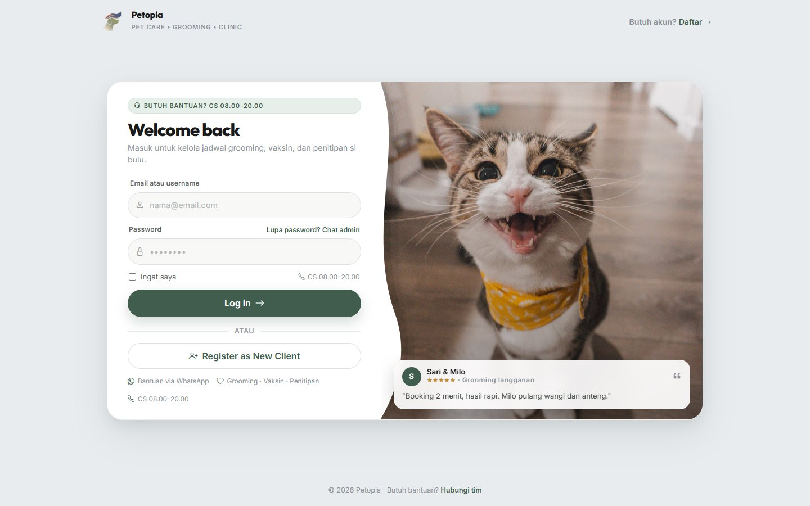</td>
<td width="50%">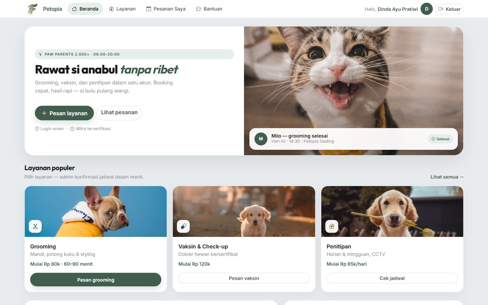</td>
</tr>
<tr>
<td align="center"><sub><b>Login</b> — satu pintu untuk admin &amp; klien</sub></td>
<td align="center"><sub><b>Beranda klien</b> — layanan populer &amp; pesanan terbaru</sub></td>
</tr>
<tr>
<td width="50%">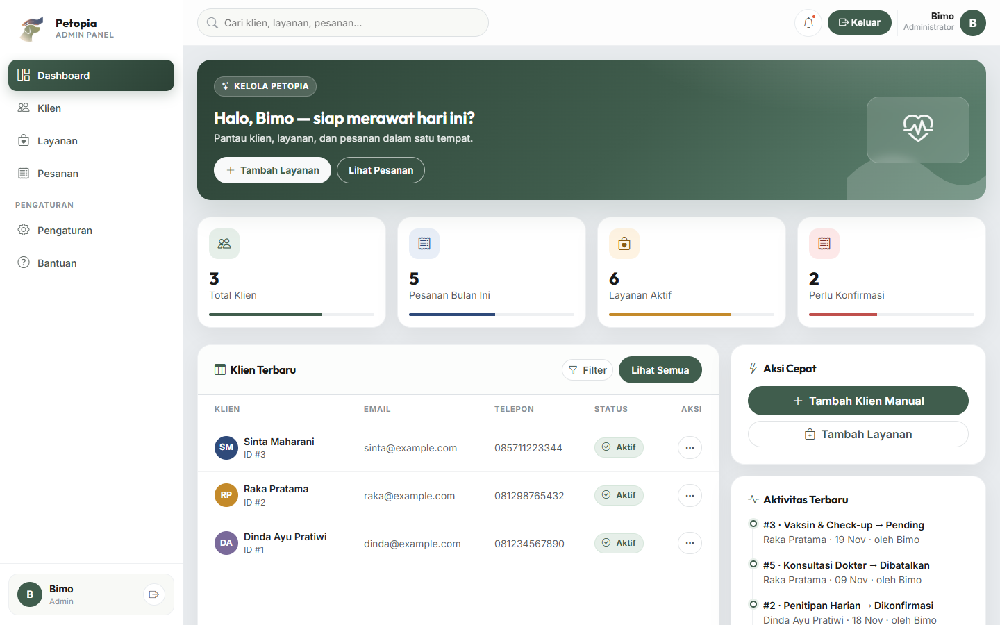</td>
<td width="50%">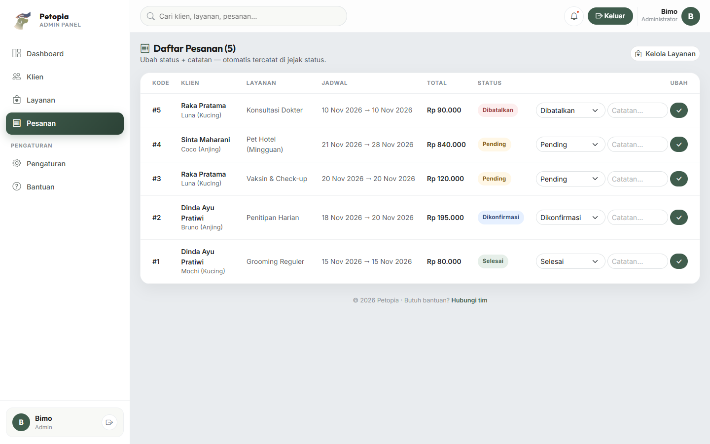</td>
</tr>
<tr>
<td align="center"><sub><b>Dashboard admin</b> — KPI, klien baru, aktivitas</sub></td>
<td align="center"><sub><b>Kelola pesanan</b> — ubah status + catatan</sub></td>
</tr>
</table>

<details>
<summary><b>Lihat tangkapan layar lainnya</b> (katalog, booking, aktivitas, whitebox)</summary>

<br>

<table>
<tr>
<td width="50%">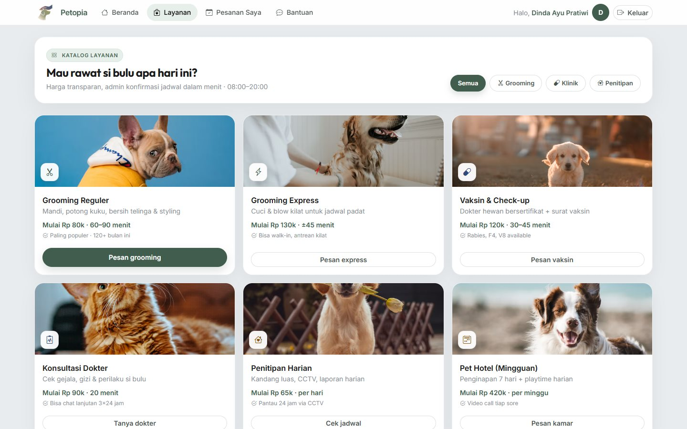</td>
<td width="50%">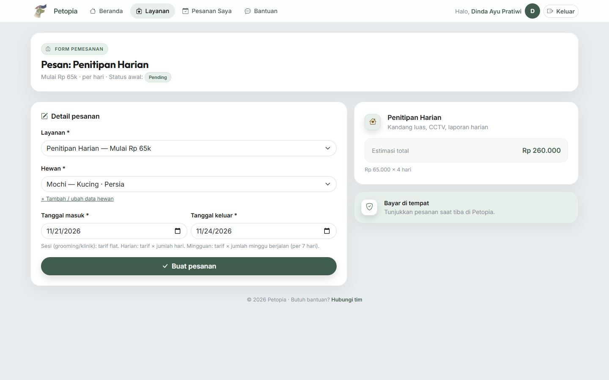</td>
</tr>
<tr>
<td align="center"><sub><b>Katalog layanan</b> — filter kategori &amp; harga</sub></td>
<td align="center"><sub><b>Booking</b> — estimasi total otomatis</sub></td>
</tr>
<tr>
<td width="50%">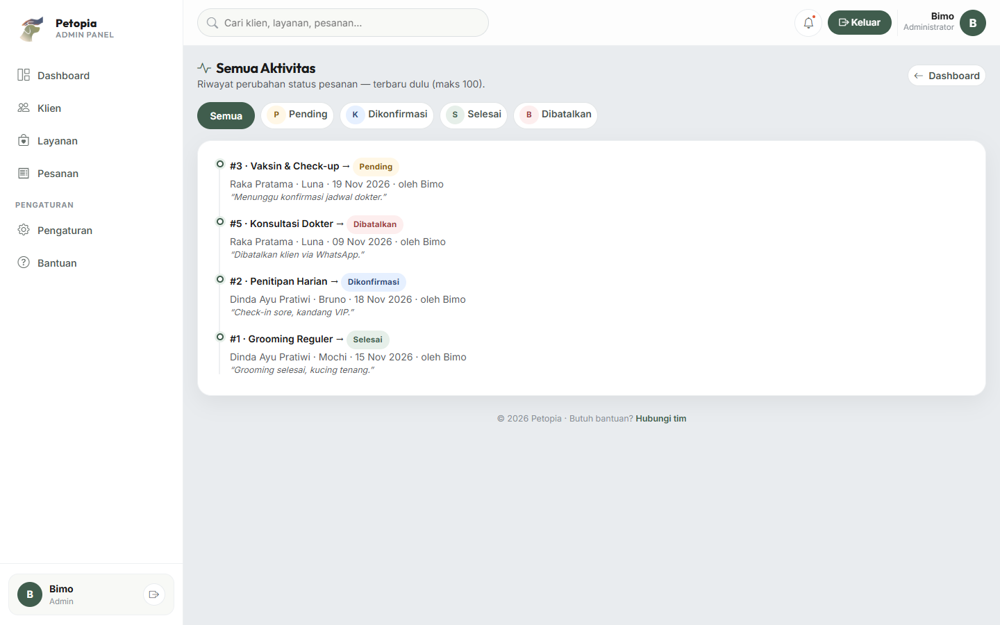</td>
<td width="50%">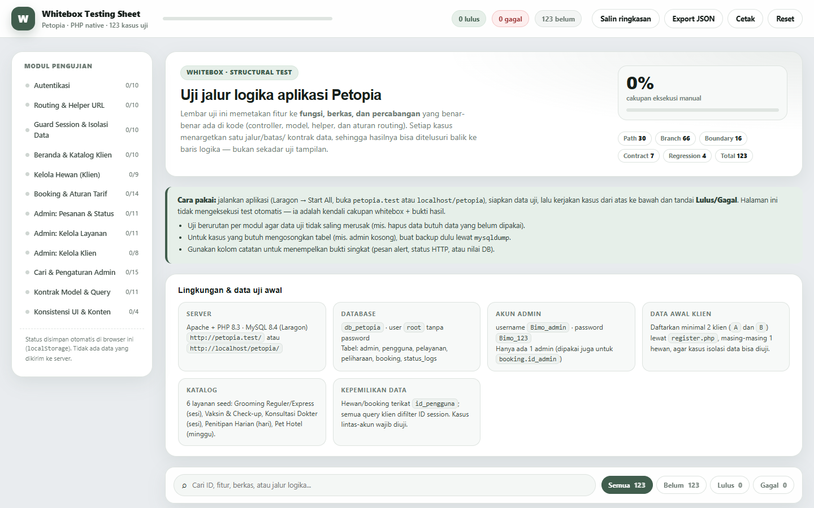</td>
</tr>
<tr>
<td align="center"><sub><b>Riwayat aktivitas</b> — filter status pesanan</sub></td>
<td align="center"><sub><b>Whitebox test sheet</b> — 123 kasus uji</sub></td>
</tr>
</table>

</details>

---

## 🧱 Teknologi

| Lapisan | Dipakai |
|---|---|
| Bahasa | PHP 8.3 (tanpa framework, tanpa Composer) |
| Database | MySQL 8.4 via `mysqli` |
| UI | Bootstrap 5.3 (CDN) + Bootstrap Icons + Google Fonts (Outfit & Inter) |
| Pola | MVC sederhana: `routes/` → `Controllers/` → `Models/` → `Views/` |
| Web server | Apache + `mod_rewrite` (Laragon) |
| Pengujian | Lembar uji whitebox &amp; blackbox manual (`whitebox.html`, `blackbox.html`) |

---

## 🏗️ Arsitektur

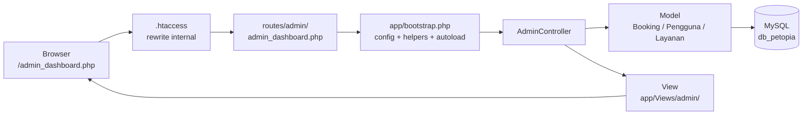

**Alur satu request**

1. `.htaccess` memetakan URL publik lama (mis. `/admin_dashboard.php`) ke file tipis di `routes/`.
2. File route memuat `app/bootstrap.php` yang menyiapkan koneksi DB, helper, model, dan controller.
3. Controller menjalankan **guard role**, memanggil model, lalu merender view.
4. View hanya presentasi; seluruh data dikirim dari controller.

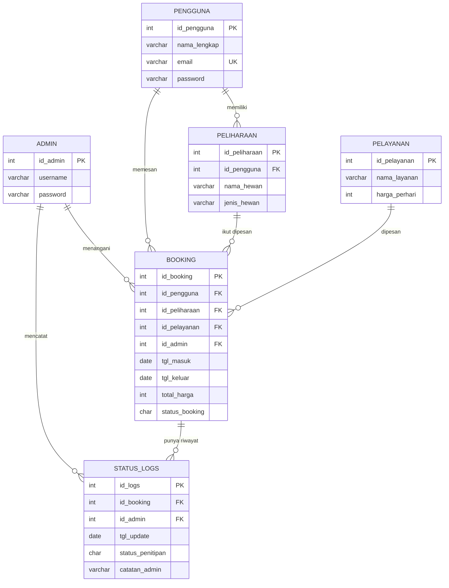

### Struktur folder

```text
petopia/
├── app/
│   ├── bootstrap.php           # wiring config + helper + model + controller
│   ├── Controllers/            # AuthController, KlienController, AdminController
│   ├── Core/helpers.php        # base_url(), asset(), redirect(), require_role(), view()
│   ├── Models/                 # 6 model (admin, pengguna, layanan, peliharaan, booking, log)
│   └── Views/
│       ├── auth/               # login, register, syarat
│       ├── klien/              # beranda, layanan, hewan, pesan, pesanan, bantuan
│       ├── admin/              # dashboard, pesanan, layanan, klien, cari, aktivitas, ...
│       └── partials/           # navigasi, footer, layout admin
├── asset/                      # css, js, img
├── config/database.php         # kredensial + koneksi mysqli
├── database/db_petopia.sql     # skema + seed (admin & 6 layanan)
├── docs/                       # screenshot untuk README
├── routes/
│   ├── auth/                   # 6 route publik
│   ├── klien/                  # 9 route klien
│   └── admin/                  # 14 route admin
├── .htaccess                   # peta URL publik → routes/
├── whitebox.html               # lembar uji whitebox (123 kasus)
├── blackbox.html               # lembar uji blackbox (163 kasus + 10 skenario)
└── README.md
```

> URL publik **tidak berubah** setelah refactor: `login.php`, `admin_dashboard.php`, dst.
> tetap diakses dari root. `.htaccess` hanya melakukan rewrite internal ke `routes/`.

---

## 🚀 Instalasi

### Prasyarat

- [Laragon](https://laragon.org/) (Apache + PHP 8.3 + MySQL 8.4) atau stack setara
- `mod_rewrite` aktif dan `AllowOverride All` pada direktori proyek
- Browser modern

### Langkah

```bash
# 1. Clone ke folder web server
git clone https://github.com/Bim-git-hub/petopia.git C:\laragon\www\petopia

# 2. Jalankan Apache + MySQL (Laragon → Start All)
```

**3. Impor database**

Lewat terminal:

```bash
mysql -u root < database/db_petopia.sql
```

Atau lewat phpMyAdmin: **Import** → pilih `database/db_petopia.sql`.

**4. Sesuaikan koneksi (bila perlu)**

Edit `config/database.php`:

```php
$host     = "localhost";
$user     = "root";
$password = "";
$database = "db_petopia";
```

**5. Buka aplikasi**

- Virtual host Laragon: **http://petopia.test/**
- Atau subfolder: **http://localhost/petopia/**

### Akun demo

| Peran | Login | Password |
|---|---|---|
| Admin | `Bimo_admin` | `Bimo_123` |
| Klien | daftar sendiri lewat halaman **Register** | — |

> Seed database hanya berisi 1 admin dan 6 layanan. Data klien, hewan, dan pesanan
> sengaja kosong agar siap dipakai demo. Ganti password admin sebelum dipakai di
> lingkungan nyata.

### Kalau muncul 404

Proyek ini bergantung pada `mod_rewrite`. Pastikan:

1. `LoadModule rewrite_module` tidak dikomentari di `httpd.conf`.
2. Direktori proyek memakai `AllowOverride All`.
3. Restart Apache setelah mengubah konfigurasi.

> Jangan memakai `php -S` (built-in server) — `.htaccess` diabaikan, semua URL publik
> akan 404.

---

## 💰 Aturan Bisnis

### Satuan tagih

| Satuan | Perilaku | Contoh |
|---|---|---|
| **Sesi** | Harga flat, tanggal tidak memengaruhi | Grooming Reguler Rp 80.000 |
| **Hari** | Harga × jumlah hari inklusif, minimum 1 | 21 → 24 Nov = 4 hari |
| **Minggu** | Harga × blok 7 hari berjalan, minimum 1 | 8 hari dihitung 2 minggu |

Rumus server ada di `BookingModel::hitungTotal()`; estimasi di `pesan.php` memakai
aturan yang sama persis.

### Status pesanan

| Kode | Label | Warna | Arti |
|:---:|---|---|---|
| `P` | Pending | kuning | Menunggu konfirmasi admin |
| `K` | Dikonfirmasi | biru | Jadwal disetujui |
| `S` | Selesai | hijau | Layanan tuntas |
| `B` | Dibatalkan | merah | Dibatalkan klien/admin |

Setiap perubahan status dicatat ke tabel `status_logs` (pelaku, tanggal, catatan).
Jejak ini tampil di dashboard admin dan halaman **Aktivitas**.

### Data yang dilindungi

- Layanan/klien yang sudah dipakai pesanan **tidak bisa dihapus** (FK `RESTRICT`).
- Klien hanya bisa menghapus hewan miliknya sendiri (filter `id_pengguna`).
- Booking hanya bisa memakai hewan milik klien yang sedang login.

---

## 🗺️ Peta URL

<table>
<tr><th>Publik</th><th>Klien</th><th>Admin</th></tr>
<tr>
<td valign="top">

`login.php`<br>
`register.php`<br>
`syarat.php`<br>
`logout.php`

</td>
<td valign="top">

`index.php`<br>
`layanan.php`<br>
`hewan.php`<br>
`pesan.php`<br>
`pesanan.php`<br>
`bantuan.php`

</td>
<td valign="top">

`admin_dashboard.php`<br>
`admin_pesanan.php`<br>
`admin_layanan.php`<br>
`admin_klien.php`<br>
`admin_cari.php`<br>
`admin_aktivitas.php`<br>
`admin_pengaturan.php`<br>
`admin_bantuan.php`

</td>
</tr>
</table>

Semua aksi tulis dijaga `require_role()` di controller. Form pengubahan data memakai
**POST**; aksi hapus memakai tautan dengan konfirmasi, validasi ID, dan pengecekan
kepemilikan data sebelum query dijalankan.

---

## 🧪 Pengujian Whitebox

Proyek menyertakan lembar uji **`whitebox.html`** — halaman interaktif berisi
**123 kasus uji** dalam **12 modul**, dipetakan langsung ke fungsi, berkas, dan
percabangan di kode (bukan sekadar checklist tampilan).

Buka: **http://petopia.test/whitebox.html**

<table>
<tr>
<td width="55%"></td>
<td width="45%">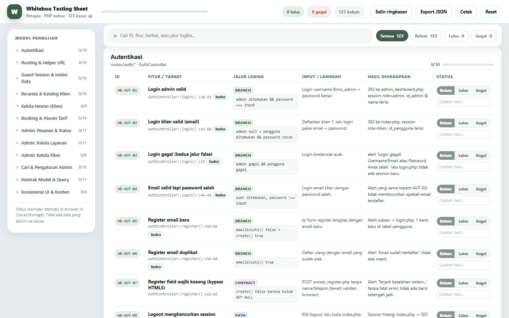</td>
</tr>
</table>

Yang dicakup antara lain:

- **Branch & boundary** `BookingModel::hitungTotal()` (sesi / hari / minggu)
- Alur login admin vs klien dan validasi registrasi
- Guard role, isolasi data antar-klien, dan proteksi FK saat hapus
- Validasi form admin (telepon, username unik, ganti password)
- Rewrite `.htaccess` + `base_url()` pada vhost maupun subfolder
- Kontrak model (`statusLabel`, `firstId`, `delete` gagal-halus)

Fitur halaman: status **Belum / Lulus / Gagal**, catatan hasil, filter, pencarian,
progres per modul, ekspor JSON, dan mode cetak. Status tersimpan otomatis di
`localStorage` browser.

### Pengujian Blackbox

Lembar uji **`blackbox.html`** menguji perilaku aplikasi dari sisi pengguna:
**input konkret → output yang diharapkan**, bukan jalur kode. Isinya:

- **10 skenario end-to-end** — alur klien baru → booking → konfirmasi → selesai,
  guard role & isolasi dua akun, empat varian tarif, validasi booking,
  pengelolaan pesanan/layanan/klien, pencarian global, pengaturan admin, dan UI publik.
- **163 kasus uji** dalam **11 modul** (AUT, AKS, KLI, HWN, BKG, PSN, LAY, KLN,
  CRG, SEC, UI) — setiap kasus memuat prasyarat, data input, output yang diharapkan,
  status Lulus/Gagal, dan kolom hasil aktual.
- Data akun, hewan, layanan, dan booking contoh yang siap dipakai, plus query SQL
  untuk memverifikasi bahwa output di layar sama dengan isi database.

Buka: **http://petopia.test/blackbox.html** (atau `localhost/petopia/blackbox.html`).

> Beberapa kasus sengaja menguji jalur gagal/destruktif (mengosongkan tabel admin,
> menghapus data, mengganti password). Jalankan di database salinan dan backup dulu.

---

## 🔐 Catatan Keamanan

Proyek ini dibuat untuk **tujuan pembelajaran/demo**, jadi ada beberapa batasan yang
perlu diketahui sebelum dipakai di produksi:

- Password disimpan **plaintext** — jangan pernah dipakai apa adanya untuk data nyata.
- Belum ada proteksi **CSRF** pada form.
- Query memakai `mysqli_real_escape_string` (bukan prepared statement).
- Tidak ada rate limiting pada login.

Yang sudah diterapkan:

- Guard role di setiap controller (`require_role()`).
- Escape output dengan `htmlspecialchars()` di view.
- Validasi input tanggal, ID, dan kepemilikan data.
- Error DB tidak membocorkan detail ke pengguna.

---

## 🤝 Kontribusi

1. Fork repo dan buat branch fitur: `git checkout -b fitur/nama-fitur`
2. Commit perubahan: `git commit -m "Tambah fitur ..."`
3. Push dan buka Pull Request.

Mohon jaga konsistensi struktur `routes/` → `Controllers/` → `Models/` → `Views/`,
serta aturan bentuk UI: **tombol/badge/input = pill, kartu = 20px, avatar = bulat**
dengan tema hijau `#405d4d` dan abu `#e9ecef`.

---

<div align="center">

**Petopia** · Grooming · Vaksin · Penitipan

Butuh bantuan? [WhatsApp admin](https://wa.me/6285242539520) · CS 08.00–20.00

<sub>Dibuat dengan PHP native, MySQL, dan sedikit cinta untuk hewan. 🐾</sub>

</div>
